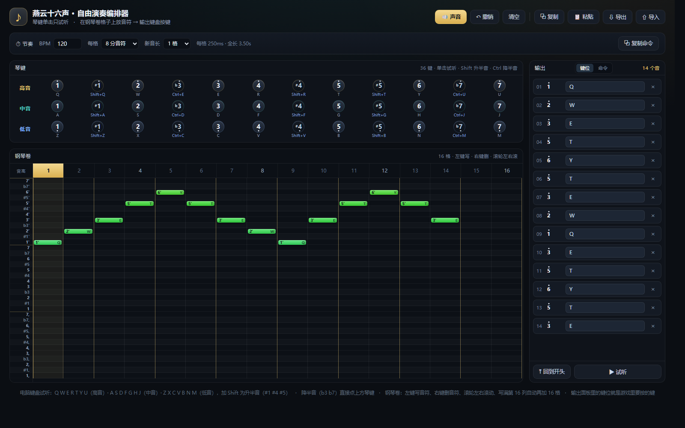
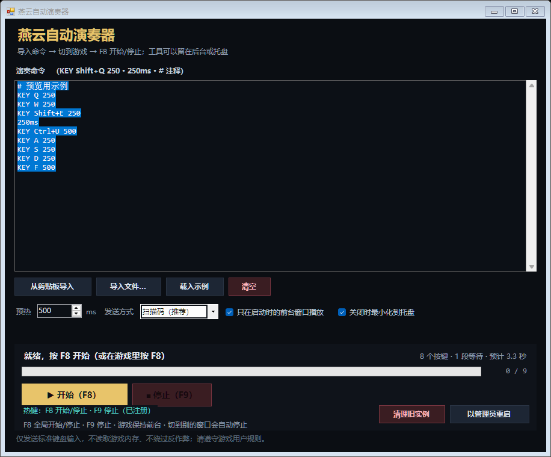
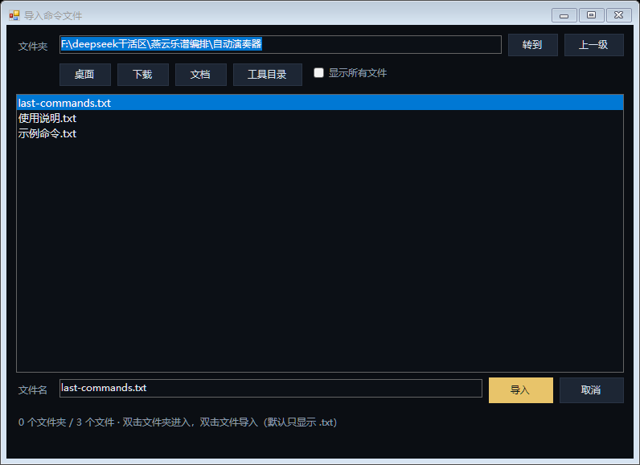

# 燕云十六声 · 自由演奏编排器 + 自动演奏器

> **一句话**：把《燕云十六声》自由演奏的 36 键谱子排出来，再让工具在游戏里按 F8 自动弹。
>
> A 36-key score arranger and F8 auto-player for *Where Winds Meet* (燕云十六声) free-play instruments. Windows only.


> **非官方工具。** 只发送标准 Windows 键盘输入，不读取游戏内存、不修改游戏文件、不绕过反作弊。
> 在网游里使用自动化演奏可能违反游戏用户协议，请自行判断风险；建议只用于个人练习和娱乐。

---

## 目录

- [它是什么](#它是什么)
- [界面预览](#界面预览)
- [目录结构](#目录结构)
- [快速开始](#快速开始)
- [详细使用：从编排器到游戏](#详细使用从编排器到游戏)
  - [1. 游戏侧准备](#1-游戏侧准备)
  - [2. 36 键位表](#2-36-键位表)
  - [3. 编排器](#3-编排器)
  - [4. 自动演奏器](#4-自动演奏器)
  - [5. 命令格式](#5-命令格式)
  - [6. 从简谱到游戏：完整流程](#6-从简谱到游戏完整流程)
- [故障排查](#故障排查)
- [常见问题](#常见问题)
- [从源码构建](#从源码构建)
- [文件说明](#文件说明)
- [GitHub 仓库简介（About）](#github-仓库简介about)
- [许可证](#许可证)
- [免责声明](#免责声明)

---

## 它是什么

这套工具分两部分：

| 部分 | 文件 | 作用 |
|---|---|---|
| **编排器** | `arranger/燕云自由演奏编排器.html` | 36 键（低音 do – 高音 si）乐谱编排：琴键、钢琴卷、输出面板；支持简谱/MIDI/粘贴/导出 |
| **自动演奏器** | `player/燕云自动演奏器.exe` | 把编排器输出的 `KEY ...` 命令按时间在游戏里自动按出来；F8 全局热键，工具可以留在托盘 |

两边通过一段纯文本命令衔接：

```text
# 120 BPM · 每格 1/8 音符 = 250ms
KEY Q 250
KEY W 250
KEY Shift+E 500
250ms
KEY Ctrl+U 500
```

编排器负责“写什么音、什么节奏”，演奏器负责“什么时候按哪个键”。

---

## 界面预览

**编排器**



**自动演奏器**



**内置文件选择器**（不再调用 Windows 资源管理器对话框；普通权限也不会因为第三方 shell 扩展闪退）



> 编排器是一个纯静态网页，直接用浏览器打开 `arranger/燕云自由演奏编排器.html` 即可，不需要安装任何东西。

编排器布局：

```text
┌──────────────────────────────────────┬────────────────┐
│ 琴键：高音 / 中音 / 低音，3 排 × 12 键  │ 输出            │
├──────────────────────────────────────┤ 键位 / 命令     │
│ 钢琴卷：36 行音高 × 时间格              │                │
│ 左侧音高栏（1' / 1 / 1,）              │ 复制命令 → 演奏器 │
└──────────────────────────────────────┴────────────────┘
```

---

## 目录结构

```text
yysls-freeplay-arranger/
├─ LICENSE
├─ README.md
├─ .gitignore
├─ 启动编排器.bat                 # 可选：双击打开 arranger 里的 html
├─ arranger/
│  ├─ 燕云自由演奏编排器.html      # 编排器入口
│  ├─ 燕云自由演奏编排器.css
│  └─ 燕云自由演奏编排器.js
├─ player/
│  ├─ 燕云自动演奏器.exe           # Windows 演奏器（.NET Framework 4.x）
│  ├─ 燕云自动演奏器.cs            # 完整 C# 源码
│  ├─ 以管理员身份运行.bat         # 自动挑同目录最新 exe，提权启动
│  ├─ 示例命令.txt
│  └─ 使用说明.txt                 # 一页纸快速上手
└─ images/
   ├─ arranger.png
   ├─ player.png
   └─ file-picker.png
```

运行时，演奏器会在 `player/` 里生成：

- `last-commands.txt`：上次导入的命令（下次自动载入）
- `settings.ini`：预热/发送方式/前台保护/托盘/上次文件夹
- `crash.log`：仅出错或导入文件时记录诊断信息

这些文件已加入 `.gitignore`，不需要提交。

**直接入口：**

- 编排器：[`arranger/燕云自由演奏编排器.html`](arranger/燕云自由演奏编排器.html)
- 演奏器：[`player/燕云自动演奏器.exe`](player/燕云自动演奏器.exe)
- 快速说明：[`player/使用说明.txt`](player/使用说明.txt)

---

## 快速开始

### 1. 打开编排器

双击 `arranger/燕云自由演奏编排器.html`（或双击仓库根目录的 `启动编排器.bat`）。

### 2. 排谱

在钢琴卷上：

- **左键**点格子写音符
- **右键**点音符删除
- 拖音符块**右边缘**改音长
- **滚轮**左右滚动
- 写满第 16 列会自动再加 16 格
- 点顶部列号可以设置试听起点

顶部节奏条可以设 **BPM / 每格时值 / 新音长**。

### 3. 复制命令

在右侧输出面板切到 **「命令」** 标签，点 **「复制命令」**。

### 4. 打开演奏器

双击 `player/燕云自动演奏器.exe`。

> 建议用 `player/以管理员身份运行.bat` 启动，尤其是游戏本身以管理员运行时。
> Windows 不允许普通权限程序给管理员权限的游戏发送按键。

### 5. 导入

点 **「从剪贴板导入」**，或 **「导入文件…」** 选择 `.txt`，或把 `.txt` 直接拖进窗口。

### 6. 切到游戏，按 F8

保持游戏在前台，按 **F8** 开始，再按 **F8** 停止；**F9** 随时停止。

> **第一次用请先看底部热键状态**：绿色「F8/F9 已注册」才说明这个窗口能收到 F8。
> 如果显示红色「F8/F9 被占用」，说明还有旧实例/别的软件占着 F8，点 **「清理旧实例」**（建议管理员运行）。

---

## 详细使用：从编排器到游戏

### 1. 游戏侧准备

1. 打开游戏里的乐器，进入 **自由演奏**。
2. 确认是 **36 键模式**。游戏自由演奏的设置里可以切换 36/21 键（部分版本按 `F1` 打开设置）；本工具按 36 键编写，21 键模式没有半音（`#1`、`b3`、`#4`、`#5`、`b7` 会没有声音）。
3. 建议用 **窗口化 / 无边框窗口** 运行游戏。全屏独占模式有时会拦截模拟按键，也容易在切窗口时丢失焦点。
4. 演奏时游戏必须保持在前台。工具默认开启「只在启动时的前台窗口播放」，你 Alt+Tab 切走会立即停止并松开所有按键。
5. 如果游戏是「以管理员身份运行」的，工具也要用管理员启动，否则 `SendInput` 会被 Windows 的 UIPI 拦截。

### 2. 36 键位表

这是工具和游戏共用的键位：三排分别对应高音/中音/低音，每排 12 个半音。

| 简谱 | 高音 | 中音 | 低音 |
|---|---|---|---|
| 1 | `Q` | `A` | `Z` |
| #1 | `Shift+Q` | `Shift+A` | `Shift+Z` |
| 2 | `W` | `S` | `X` |
| b3 | `Ctrl+E` | `Ctrl+D` | `Ctrl+C` |
| 3 | `E` | `D` | `C` |
| 4 | `R` | `F` | `V` |
| #4 | `Shift+R` | `Shift+F` | `Shift+V` |
| 5 | `T` | `G` | `B` |
| #5 | `Shift+T` | `Shift+G` | `Shift+B` |
| 6 | `Y` | `H` | `N` |
| b7 | `Ctrl+U` | `Ctrl+J` | `Ctrl+M` |
| 7 | `U` | `J` | `M` |

音域：**低音 1（C3）→ 高音 7（B5）**，共 36 个半音。

> 升半音（`#1`/`#4`/`#5`）按住 **Shift**；降半音（`b3`/`b7`）按住 **Ctrl**。
> 这是游戏自由演奏的默认布局；如果你的游戏版本/键位不同，改 `arranger/燕云自由演奏编排器.js` 顶部的 `OCTAVES` / `DEGREES` 即可。

### 3. 编排器

#### 布局

- **上方琴键**：3 排 × 12 键，和游戏里的键位一一对应；单击只试听，不会写入音符。
- **左侧音高栏**：36 行简谱音名（`1'` 高音、`1` 中音、`1,` 低音），和钢琴卷行对齐。
- **钢琴卷**：横轴是时间，纵轴是音高；默认 16 格，写满最后一列自动扩展。
- **右侧输出面板**：「键位」列出每个音的按键；「命令」生成演奏器用的 `KEY ...`。

#### 写谱

| 操作 | 结果 |
|---|---|
| 左键点空白格 | 在该格写入对应音高的音符 |
| 左键点已有音符块 | 试听该音（不新增） |
| 右键点音符块 | 删除 |
| 拖音符块右边缘 | 改音长（按整格吸附，上限 6 秒） |
| 滚轮 | 钢琴卷左右滚动 |
| 点顶部列号 | 选择试听起点（按钮变成「▶ 从第 N 列试听」） |
| `Home` / 「回到开头」 | 回到第 1 列并复位试听 |
| 写满第 16 列 | 自动扩展为 32 格，以此类推 |

#### 节奏

- **BPM**：30–300。
- **每格**：4 / 8 / 16 / 32 分音符；每格毫秒数实时显示。
- **新音长**：新写入音符默认占 1 / 2 / 4 / 8 / 16 格；写完后仍可拖右边缘改。
- 一个音最多按住到下一个音开始，且不超过 6 秒。
- 红色竖线是拍线：每格 16 分时每 4 格一条，8 分时每 2 格一条，4 分时每格一条。

#### 输入方式

- **手动点格子**：最直接，适合照着简谱一个音一个音落。
- **电脑键盘试听**：`Q W E R T Y U`（高音）/ `A S D F G H J`（中音）/ `Z X C V B N M`（低音）；加 `Shift` 是升半音；降半音直接点琴键。
- **粘贴**：顶栏「📋 粘贴」支持键位链（`Q → W → Shift+E`）、简谱（`1' 2' #4 b3`）或导出的 JSON。
- **导入文件**：`.json` / `.txt` / `.mid` / `.midi`。
- **MIDI 导入**：自动按当前「每格」量化，整曲移八度到 C3–B5，同列和弦取最高音，并读入 MIDI 的 BPM。

#### 试听与导出

- **▶ 试听**：按 BPM、每格时值和每个音自己的长度精确排队；音符块和琴键同步高亮。
- **⤒ 回到开头**：列选中、滚动位置、试听起点一起复位。
- **复制**：复制键位链（`Q → W → Shift+E×2`）。
- **复制命令**：复制 `KEY ...` 命令流，给演奏器用。
- **导出**：JSON，包含 `cols`、`timing`、每个音的 `col/len/midi/name/keys`。
- **导入**：文件先预览，确认后再替换/追加；可撤销。

#### 一个建议

编排器的试听是浏览器里的简单合成音，只用来核对**音高和节奏**，不要拿它当音色参考。最终效果以游戏里的乐器为准。

### 4. 自动演奏器

#### 4.1 导入命令

三种方式：

1. **从剪贴板导入**：在编排器点「复制命令」，再点这个按钮（最常用）。
2. **导入文件…**：打开内置文件选择器，默认只显示 `.txt`；可以勾「显示所有文件」，也可以把完整路径粘到「文件名」。
3. **拖拽**：把 `.txt` 直接拖进演奏器窗口。

导入后会显示：

- `N 个按键 · M 段等待 · 预计 X 秒`
- 有错时红字指出第几行；例如 `第 3 行：格式应为 KEY 按键 按住ms`

#### 4.2 参数

| 参数 | 说明 |
|---|---|
| **预热** | 按 F8 后先等多久再发第一个音，默认 500ms；第一个音总被吃掉就调到 800–1000ms |
| **发送方式** | 默认「扫描码（推荐）」；如果游戏完全没反应，切「虚拟键」再试 |
| **只在启动时的前台窗口播放** | 默认开启；播放中切到别的窗口会立即停止并松开按键。建议保持开启 |
| **关闭时最小化到托盘** | 默认开启；关闭窗口后 F8/F9 仍然有效 |

#### 4.3 开始/停止

| 操作 | 结果 |
|---|---|
| 游戏前台按 `F8` | 开始；再按一次停止 |
| 游戏前台按 `F9` | 立即停止 |
| 点「▶ 开始（F8）」 | 3 秒倒计时，倒计时内切到游戏即可 |
| 点「■ 停止（F9）」 | 立即停止 |

停止时会**松开所有按下的键**，不会留下卡键；播放中切走窗口也会自动松开。

#### 4.4 热键状态与旧实例

底部有一行常驻状态：

- 绿色 **「热键：F8 开始/停止 · F9 停止（已注册）」**：当前窗口能收到 F8/F9。
- 红色 **「热键：F8/F9 被占用 · 先退出旧实例，或点『清理旧实例』」**：F8 被别的进程占着。

常见情况：你之前开过多个自动演奏器，旧窗口缩在托盘里，F8 被旧实例抢走了。表现就是：

> 游戏里按 F8，听到的却是「高音 do 到 si」的示例。

解决：

1. 用 `以管理员身份运行.bat` 启动**最新**的 `燕云自动演奏器.exe`；
2. 点 **「清理旧实例」** → 确认；
3. 等底部热键状态变绿，再切到游戏按 F8。

新版会每 3 秒自动重试注册热键，旧实例退出后会自动接管，不需要重启。

#### 4.5 管理员权限

以下情况需要以管理员身份运行演奏器：

- 游戏本身是「以管理员身份运行」；
- 你点了「清理旧实例」但提示旧实例是管理员权限、普通权限关不掉；
- 游戏以全屏独占运行，普通权限发送按键无效。

启动方式：

- 右键 `燕云自动演奏器.exe` → **以管理员身份运行**；
- 或者双击 `以管理员身份运行.bat`（自动挑同目录最新的 exe，并弹 UAC）；
- 或者在工具里点 **「以管理员重启」**。

工具底部会显示当前是否已经是管理员（按钮变成「已是管理员」）。

#### 4.6 后台/托盘

- 点窗口右上角 ×：默认收进托盘，F8/F9 仍然有效。
- 点最小化：默认也收进托盘。
- 托盘图标右键：显示主界面 / 退出。
- 如果通过 UAC 启动后没看到窗口，先看托盘；新版会自动把「启动时就是最小化」的窗口恢复正常大小。

### 5. 命令格式

演奏器只认下面这几类行：

```text
KEY Shift+Q 250      按下 Shift+Q，保持 250ms，然后松开
KEY Ctrl+E 500       按下 Ctrl+E，保持 500ms
250ms                等待/休止 250ms
# 注释               以 # 开头的行会被忽略
```

兼容写法：

| 写法 | 等价于 |
|---|---|
| `KEY Q 250ms` | `KEY Q 250` |
| `KEY Q 250 ms` | `KEY Q 250` |
| `KEY ↑Q 250` | `KEY Shift+Q 250` |
| `KEY ↓E 250` | `KEY Ctrl+E 250` |
| `KEY ⇧Q 250` | `KEY Shift+Q 250` |
| `KEY ⌃E 250` | `KEY Ctrl+E 250` |
| `250`（单独一行） | `250ms` |

说明：

- 一行只能有一个 `KEY`；不支持和弦。
- `KEY` 后面的最后一个数字是**按住毫秒数**，不是等待。
- 两个音之间的间隔由单独的 `250ms` 行控制；编排器的「命令」页会自动生成好这些等待行。
- 大小写不敏感；`Shift`/`LShift`/`Ctrl`/`LControl` 都认。

### 6. 从简谱到游戏：完整流程

假设你拿到一首歌的简谱，想把它变成游戏里能自动弹的 36 键谱：

#### 第 1 步：定调、定音域

- 先看简谱的调号（`1=C`、`1=G` 等）。本工具按**绝对音高** C3–B5 排；如果原曲音域超出，先在简谱上整体移八度，或只取主旋律。
- 36 键覆盖三个八度；绝大多数流行歌的主旋律都放得下。
- 21 键模式没有半音；如果游戏只能用 21 键，带 `#`/`b` 的音要改成相邻自然音，效果会变。

#### 第 2 步：在编排器里落音

- 按 [36 键位表](#2-36-键位表) 找到每个简谱音对应的键，在钢琴卷对应行点一下。
- 先不管时值，把音高落对；再回头拖音长。
- 如果简谱是一段一段的，可以用「粘贴」直接写：`1' 2' 3' 5'`，或 `Q W E G`。

#### 第 3 步：调节奏

- 设 BPM（和原曲一致或稍慢）。
- 选「每格」：常见 8 分或 16 分；三连音多的曲子选 16/32 分更准。
- 拖每个音的右边缘改音长；空出来的格子就是休止。
- 点「▶ 试听」核对；不满意就改 BPM/格/音长。

#### 第 4 步：复制命令

- 切到「命令」标签，确认是 `KEY ...` 和 `250ms` 交替的行。
- 点「复制命令」。

#### 第 5 步：导入演奏器

- 打开 `燕云自动演奏器.exe`（建议管理员）。
- 点「从剪贴板导入」。
- 确认摘要里的按键数和预计时长；有错先按提示修。

#### 第 6 步：进游戏

- 打开乐器自由演奏，确认 36 键模式，游戏在前台。
- 按 F8。
- 如果第一个音被吃掉：把「预热」调到 800–1000ms，重试。
- 如果完全没声音：切「虚拟键」；确认工具是管理员；确认游戏在前台。
- 如果只有部分音没声：确认游戏是 36 键模式，检查 `Ctrl`/`Shift` 组合键是否被游戏其他功能占用。

#### 第 7 步：微调

- **整体偏快/偏慢**：改 BPM，重新复制命令。
- **某个音太短/太长**：回编排器拖音长，重新复制。
- **按键有延迟**：加大预热；游戏帧率/输入延迟也会影响，无法做到绝对同步。
- **听起来音不对**：先回编排器用试听核对音高；再检查游戏是否 36 键、是否移了八度。

---

## 故障排查

| 现象 | 原因 / 解决 |
|---|---|
| 游戏里按 F8 只响「高音 do 到 si」的示例 | 旧实例占着 F8。用管理员启动最新版 → 点「清理旧实例」→ 等热键变绿 → 再按 F8 |
| 底部热键一直红色「F8/F9 被占用」 | 还有旧实例，或别的软件占用 F8。清理旧实例；退出占用 F8 的软件；新版每 3 秒自动重试 |
| 导入文件窗口闪退 | 用最新版（内置文件选择器，不再调用系统对话框）；或改用「从剪贴板导入」/拖拽 `.txt`；仍有问题把 `crash.log` 发出来 |
| 播放完成但游戏完全没声音 | 工具不是管理员（游戏是管理员）；游戏不在前台；发送方式试试「虚拟键」；游戏不是 36 键模式；反作弊/Raw Input 忽略模拟输入 |
| 只有部分音没声 | 21 键模式没有半音；`Ctrl`/`Shift` 被游戏其他功能占用；音高超出 C3–B5 |
| 按 F8 没反应，但点「开始」可以 | F8 被占用/未注册；看底部热键状态；清理旧实例 |
| 按 F8 变成了游戏里的其他功能 | 工具注册了全局 F8，会截走游戏 F8；目前固定 F8/F9，要改可改源码里的 `Keys.F8`/`Keys.F9` |
| 播放中切窗口就停了 | 默认开启「只在启动时的前台窗口播放」，这是防止把按键发到聊天框；需要的话可取消勾选（不推荐） |
| 键卡住了 | 按 F9 或「停止」；工具会松开所有键。不要直接强杀进程在按住长音的时候 |
| 第一次运行被 SmartScreen 拦 | 「更多信息 → 仍要运行」；exe 是本地编译的未签名程序，源码在仓库里 |
| 杀毒软件报毒 | 工具会调用 `SendInput` 模拟键盘，可能被启发式误报；可加白名单，或自己从源码编译 |
| 关闭窗口后找不到工具 | 默认收进托盘；托盘图标右键「显示主界面」或「退出」 |
| 旧 exe 删不掉/覆盖不了 | 旧实例还在运行并锁着文件；管理员启动最新版 → 清理旧实例，再删 |

---

## 常见问题

**Q：这算外挂吗？会被封号吗？**

它不是外挂：不读内存、不改游戏文件、不绕过反作弊，只是用 Windows 标准 `SendInput` 模拟键盘。
但“自动演奏”属于游戏自动化，**可能违反游戏用户协议**；是否使用、是否风险自负，请自己判断。建议只用于个人练习/娱乐。

**Q：支持 21 键模式吗？**

编排器按 36 键编写；21 键只有自然音，`#1`/`b3`/`#4`/`#5`/`b7` 不会发声。要在 21 键用，需要把半音改成相邻自然音（效果会变）。

**Q：支持其他乐器吗？**

只要该乐器使用游戏同一套 36 键自由演奏布局，就可以。不同乐器的音色不同，键位通常一致。

**Q：为什么一定要游戏在前台？**

Windows 的 `SendInput` 发送到当前前台窗口；工具默认还会校验前台进程，防止你把整首谱子打进聊天框。

**Q：为什么有时要管理员？**

游戏以管理员运行时，Windows 的 UIPI 会阻止普通权限程序向它发送按键。两边权限要匹配。

**Q：macOS / Linux 能用吗？**

不能。演奏器是 Windows WinForms + Win32 `SendInput`；编排器是纯网页，任何系统都能打开，但只能在 Windows 上配合演奏器自动弹。

**Q：能改成别的热键吗？**

目前固定 F8（开始/停止）/ F9（停止）。源码里搜 `Keys.F8` / `Keys.F9`，改完重新编译即可。

**Q：能改键位表吗？**

编排器的键位表在 `arranger/燕云自由演奏编排器.js` 顶部的 `OCTAVES` / `DEGREES`；改完刷新页面即可。演奏器只负责发送命令里的按键，不需要改。

**Q：为什么内置文件选择器这么“简陋”？**

因为 Windows 的系统文件对话框会加载第三方 shell 扩展，普通权限下某个坏扩展可能把整个进程带崩。自绘选择器不碰 shell，稳定优先；日常导入用「从剪贴板导入」最快。

**Q：能在线用编排器吗？**

编排器是纯静态 HTML/CSS/JS，可以放到 GitHub Pages / 任意静态服务器。演奏器必须下载到 Windows 本地运行。

---

## 从源码构建

### 编排器

不需要构建。`arranger/` 三个文件放在同一目录，双击 HTML 即可；改 JS/CSS 后刷新页面。

### 演奏器

需要 Windows + .NET Framework 4.x（Windows 10/11 自带），不需要 NuGet。

在 `player/` 目录打开命令提示符：

```bat
"C:\Windows\Microsoft.NET\Framework64\v4.0.30319\csc.exe" /nologo /target:winexe /platform:anycpu /optimize+ /out:燕云自动演奏器.exe 燕云自动演奏器.cs /reference:System.dll /reference:System.Core.dll /reference:System.Drawing.dll /reference:System.Windows.Forms.dll
```

32 位系统把 `Framework64` 换成 `Framework`。

源码里还有几个开发自检入口（用 `/target:exe` 编译成 console 版运行）：

```text
燕云自动演奏器.exe --selftest      # 解析/计时自检，结果写到 selftest.log
燕云自动演奏器.exe --uicheck       # 构造主界面和文件选择器，检查是否有异常
燕云自动演奏器.exe --uipreview out.png  # 把界面渲染成 PNG（开发用）
```

---

## 文件说明

| 文件 | 说明 |
|---|---|
| `LICENSE` | MIT 许可证 |
| `arranger/燕云自由演奏编排器.html` | 编排器入口；和同目录 CSS/JS 一起用 |
| `arranger/燕云自由演奏编排器.css` | 编排器样式 |
| `arranger/燕云自由演奏编排器.js` | 编排器逻辑：36 键数据、钢琴卷、命令生成、导入导出 |
| `player/燕云自动演奏器.exe` | 演奏器，Windows 10/11 |
| `player/燕云自动演奏器.cs` | 演奏器完整源码（WinForms + Win32） |
| `player/以管理员身份运行.bat` | 提权启动，自动选同目录最新 exe |
| `player/示例命令.txt` | 一段可直接导入的示例命令 |
| `player/使用说明.txt` | 一页纸快速上手 |
| `images/arranger.png` | 编排器界面截图 |
| `images/player.png` | 演奏器界面截图 |
| `images/file-picker.png` | 内置文件选择器截图 |

---

## GitHub 仓库简介（About）

可以直接复制到 GitHub 仓库右上角的 **About**：

```text
燕云十六声自由演奏 36 键乐谱编排 + 自动演奏器：简谱/MIDI → 按键谱 → F8 全局热键后台演奏。Windows / WinForms / SendInput。
```

**Topics 建议**：

```text
yanyun  yysls  燕云十六声  music  piano-roll  autoplay  winforms  csharp  windows
```

**仓库名建议**：`yysls-freeplay-arranger`

---

## 许可证

本项目使用 [MIT License](LICENSE)。

```text
Copyright (c) 2026 Kukisama
```

游戏名称、按键布局、曲目等知识产权归各自权利方所有；本项目仅用于个人学习/娱乐。
如果你 fork 后要换成自己的名字，改 `LICENSE` 第一行即可。

---

## 免责声明

- 本项目是个人兴趣工具，**不是**《燕云十六声》官方或网易相关产品。
- 只发送标准 Windows 键盘输入；不读取游戏内存、不修改游戏文件、不绕过反作弊。
- 自动化演奏可能违反游戏用户协议；是否使用及后果由使用者自行承担。
- 本项目使用 MIT 许可证；游戏名称、按键布局、曲目等知识产权归各自权利方所有。
- 不对任何因使用本工具导致的账号、数据或设备问题负责。

如果这个工具帮到你，欢迎点个 Star ⭐；有键位/节奏/兼容性问题也欢迎开 Issue。
